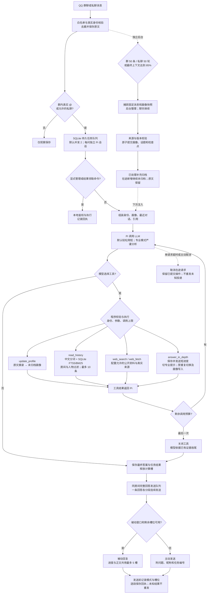

# PA 工具循环与系统流程

自然语言统一交给 Pi Agent Loop；程序只识别显式管理命令，不匹配“记住”“续问”“搜索”等语义前缀。用户消息先保存并去重，工具写入只能使用当前运行绑定的真人来源。

## 默认上下文

固定总提示词与工具定义位于前部，动态背景使用清晰标签和 JSON。画像均有 `archived`（已归档）和 `pending`（未归档）；人物画像附 `personId` 和 `senderIds`，不注入旧的分类字段。本人自述与第三方笔记仍保留来源性质，避免错误归因。

群聊默认取当前发言者最近一轮已完成、已确认发送、未归档的问答，限定最近10分钟，并按 `runId` 配对。其他群友的闲聊不自动加入，更多原文由模型调用历史工具读取。私聊保留续聊摘要及未整理历史。当前问题真实 @ 的其他人物可注入其画像；普通文本人名不作为身份绑定。

## 循环、专业模式与存储

- 默认 `PA_LOOP_MAX_MODEL_CALLS=6`、`PA_LOOP_MAX_TOOL_CALLS=8`，不设整次总时限。`PA_TIMEOUT_MS`限制单个模型请求；网络工具和后台调用各有独立请求超时，主动取消仍可中止准备和工具等待。QQ的被动回复有效期属于平台投递约束，不是Agent循环计时。
- 最后一次模型调用去除工具，预留收尾；执行层再次检查，模型违规输出工具调用也不能突破上限。Schema 无效调用不产生业务写入。
- 深入回答在同一个 Pi 会话切换专业提示，继承身份、证据和剩余预算；最终专业答案直接保存发送，不再调用日常模式重写。提示变更通过 SDK 转录转换到各供应商协议。
- 所有渠道提问进入持久任务队列，`PA_MAX_CONCURRENT_TASKS` 默认2（范围1–16）；每问使用独立 Pi 转录和锁，SQL、人物画像和后台整理仍按真实房间与人物关联。计算完成就释放计算槽，等待发送不会占着它。每房间的发送队列一次发送整条回答，进度也经过这条队列；不同房间可以同时发送。
- QQ 的进度提示独立保存在 `run_progress`，不是人物证据。被动回复窗口内优先用原消息ID与下一个回复序号，进度和正文合计最多5个槽位；过期、槽位不足或完整答案需要超过剩余槽位时主动发送（不带 `msg_id`/`msg_seq`）。主动长答仍按500字符分段。临发送时重新判断窗口，发送前记录模式与槽位。拒绝或未知投递立即停止，不自动重发。
- `/result` 或 `/result 任务编号` 可领取当前房间中本人已完成的结果，不调用模型。主动答案附昵称、问题摘要和任务短编号。重启继续尚未开始模型处理的 queued；已有运行的失败、中断和未知投递不自动重跑，完成答案仍可领取。主动发送可能受QQ权限或平台额度限制，代码不绕过这些限制。
- 当前使用腾讯官方群/私聊消息接口，公开契约没有截图中的“合并转发聊天记录”消息结构。[官方发送文档](https://github.com/tencent-connect/bot-docs/blob/main/docs/develop/api-v2/server-inter/message/send-receive/send.md)与[NapCat合并转发接口](https://napneko.github.io/onebot/api)属于不同接入方式；本次没有切换QQ客户端协议。
- 画像工具按真实来源消息和工具调用ID幂等，不能选择其他人物作为写入目标。只有工具成功提交后模型才能确认保存；之后模型请求失败也不回滚已提交画像。
- SQLite schema10迁移先备份，既有事实保留为已归档；历史分类元数据保留在旧审计记录，新画像和新产物不分类。后台只归档捕获且实际处理的 pending，跨房间版本检查避免旧任务覆盖新画像。

FTS5 索引覆盖原始消息，包括已经整理的历史。写入和索引维护在 SQLite 事务内；中文使用 Node 内置 `Intl.Segmenter` 分词，不增加运行依赖。BM25 是关键词排序，模型可以改写查询补检；不把它描述成向量语义检索。

## 验证范围

保留与身份、迁移、并发归档、事务、去重、取消、循环上限及QQ投递有关的检查。移除旧语义前缀、画像分类和独立判断/确认流程的测试，使用本地HTTP模拟模型工具协议及真实 Pi SDK/SQLite 验证整合；这些测试不证明真实模型的语义判断质量。
