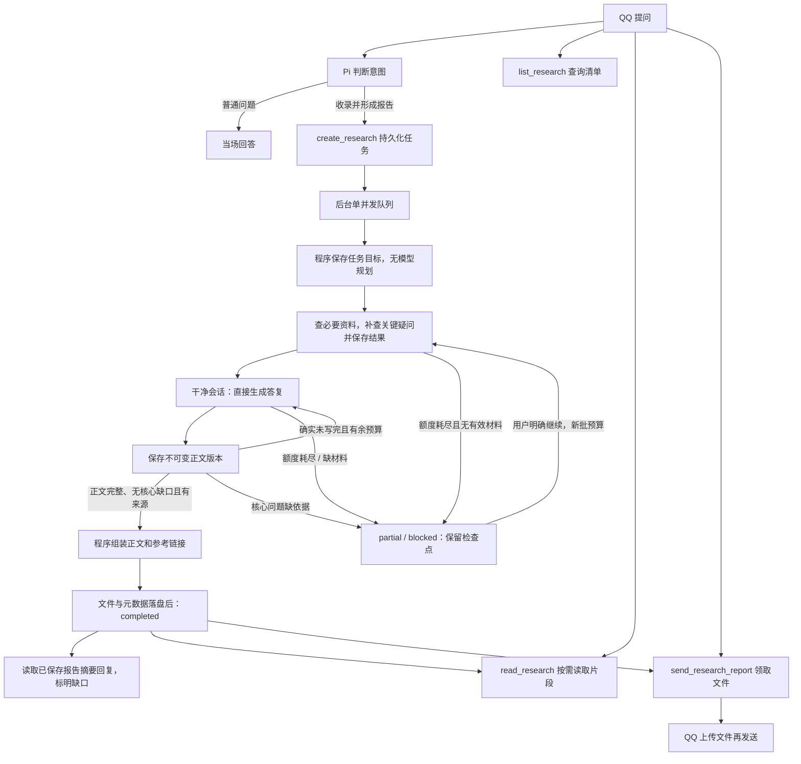

# 研究清单与后台报告

研究能力接在渠道的 Pi 工具循环中。用户明确希望收录、后台研究、形成报告或之后领取时，由模型调用 `create_research`；普通问题仍当场回答，可使用联网工具，不因为问题复杂或带链接就自动建任务。`prepare_turn.intent=research` 只表示本轮意图，不能替代实际创建工具回执。明确入清单时前台不预先独立输出调研结论；create/continue真实保存成功后结束当前工具循环，由程序短确认，不额外调用模型解释。研究意图不发送前台“我去搜索”进度；普通即时专业回答仍保留进度提示。

示例：

- “把这个链接加入研究清单，调研部署方案，晚上看报告。”
- “今天我提了多少项研究？分别进展如何？”
- “解释一下这份报告中的内存需求。”
- “把这个编号的报告发给我。”
- “这个任务刚才网络失败了，现在继续研究。”
- “把编号R…的任务从我的研究清单移除。”

## 流程与预算

默认任务是轻量理解与比较：解释概念和用途、比较关键差异、按需查社区反馈，并结合任务中明确提供的PA背景判断适用性。默认答复约300至900中文字（提示目标，不是截断上限），简单问题更短，明确要求详细时展开。不默认深入源码、穷尽所有角度或生成专业长报告；官方功能、社区个例和推断应区分。前台创建时仅携带相关的已知背景，不传整段群聊或画像。

新任务持久化`plan.version=2`，由程序直接固定一个答复单元，沿用已有正文版本存储；本地plan检查点不消耗模型调用。流程是**必要资料采集 → 独立无工具答复 → 程序保存**，不调用章节规划或反复审查。采集最多6次主模型请求（可提前结束），且必须为答复预留1次；余预算不足2次时不开始采集。模型written/blocked后结束本批，只有真实未完成的draft/length可按剩余预算续写；核心缺口通过gaps保留，不自动启动返修或新一轮搜索。

轻量材料投影最多16条、序列化条目合计40000字节、每条摘录6000字节；另有最多24条有界索引和8000字节采集笔记。截断和省略均明示，完整材料仍保留，可在采集阶段按编号补读。不会把片段或采集笔记当作全文核验。

`PA_RESEARCH_ENABLED=true` 默认开放研究工具。研究任务使用当前模型、API 配置以及现有 `PA_SEARCH_*` / `PA_FETCH_*` 配置，不增加供应商或浏览器。单独后台执行一个任务，前台普通对话仍可进行；研究预算独立于前台问答任务额度。

轻量任务使用独立的采集、答复提示词，旧任务保留规划、写作和审查提示词；均不继承前台画像或 `PA_MAX_OUTPUT_TOKENS`。仅研究开启 high 思考，DeepSeek请求显式发送 `thinking:{type:"enabled"}` 与 `reasoning_effort:"high"`，工具循环回传SDK保留的 `reasoning_content`。前台仍为非思考模式及原prepare_turn协议。OpenAI兼容研究请求不发送 `max_tokens` / `max_completion_tokens`，预留65536 tokens，实际模型窗口不足在发送前拒绝。省略参数不等于无限输出，实际供应商默认值和单次请求超时仍有效；其他供应商兼容性需另行核实。

轻量任务与旧任务共享每批16次主模型请求、24次工具调用、最多6次web_search的上限；阶段切换不重置，搜索内部的供应商调用另有统计。新协议的`completed`要求正文written、核心gaps为空、有来自实际成功工具结果的引用、可用联网证据及所有明确原文要求满足，并已保存文件与数据库元数据；不表示经过独立模型审稿。有正文但核心问题未解决或续写额度用完为partial，缺指定原文/可用联网证据或正文为blocked。失败、取消、未知调用保留现场，不自动重试；明确继续才开下一批；新的正式报告成功保存后替换旧报告正文，更新失败时保留最后可用报告。

## 旧任务的章节协议（plan.version=1）

以下章节规划、审查与完整材料展示要求仅用于已有version=1固定计划，不是新任务默认流程。为保留已有目标、正文和审查进度，续作旧计划时不静默改成version=2；没有固定计划的任务采用新流程，不新增数据库迁移，也不改旧任务记录。

首次规划输出1至8个必需章节，程序赋予固定s1..s8编号，保存目标和验收要求。写作输出先闭合 `<research_section>{status,summary,sources,gaps}</research_section>`，再给本次章节正文；正文不用JSON包裹。written进入审查，continue或有效元数据下的length保存draft，下个周期接写；返修保存新完整版本，旧版不覆盖。元数据不完整、伪调用和未知请求失败停止本批，不猜测断点或自动重发收费请求。阶段输出在解析前保存草稿摘录（90000字节），完整SDK响应另存诊断。

审查只开放本任务已保存材料的读取工具，不搜索、不抓新网页。输入按本章来源选择所有相关已存资料，不限于最新材料；投影标明未展示部分，由 `read_research_material` 按id分页续读。程序核查必需材料的展示覆盖，未完整进入当前审查上下文不能pass；模型负责判断证据是否支持结论。每次审查绑定正文版本，旧版的pass不能授权后来正文。全部章节通过后，程序拼接标题、章节、缺口和来源，不再调用模型重写报告。

每批默认最多16次主模型请求、24次工具调用，其中最多6次web_search；规划、采集、写作、审查、返修和续写共同扣减，切换阶段不重置。每批规划后先执行一次全任务collect，最多8次模型请求，并按待完成章节数尽量为每章写作/审查预留各1次。采集最后一个合法工具批次仍保持auto，由SDK完成工具执行与持久化后程序直接结束，不再追加无工具请求逼其写正文。正常采集结束只表示材料已确认落库，不保证证据足够；未知错误、取消、超时和SDK工具错误停止本批。

plan与write都是单次模型请求、从开始就无工具；write新建干净会话，仅携带任务、章节和已保存的有界材料，不继承采集阶段的assistant/tool调用历史。每次纯写作可保存完整章、续写片段或明确缺材料结果。review继续仅开放材料只读工具、每周期最多4次请求。后台不设整任务时间上限，保留单请求超时、实际模型窗口和文件容量。预算配置名称不变，搜索内部另有模型请求，16次不是全部付费请求总数。

每周期使用独立Pi会话，输入只含固定任务、章节进度、当前章节和相关材料；接写只带当前章末尾8000码点及进度摘要，审查带当前完整章。调用前固定输入与哈希落库、预记次数，成功后原子提交章节/审查和周期状态。明确 `continue_research` 才开新批预算，复用计划和已通过章节，失败请求也计次数。continue_research可携带requirements（单次最多4000码点、累计12000码点），原目标与已确认后续要求一起进入所有阶段；采集阶段同时带已有gaps。完成任务需明确新增要求才允许续作同任务，新要求使已有正文重新进入修订；未完成且无新增要求保持已有断点。不同研究对象仍应新建任务。

结束条件：

- `completed`：所有必需章均通过当前版本审查，每章有实际读取的引用网页，严格原文要求满足，最终文件与数据库元数据已提交。程序决定状态，不接受模型自行宣布整项完成。
- `partial`：有可用材料和正文，但额度耗尽或部分章缺证据；生成明确标记未完成的阶段性报告。
- `blocked`：缺指定原文、没有可用联网材料或尚无可发布正文；保留全部检查点。
- `failed`：响应协议无效或调用出错。`interrupted`：服务中断。均不自动重发未知请求，明确继续后从已确认进度恢复。

上述“审查通过”不保证事实绝对正确；真实研究质量仍需另行联调。

## 继续调研与完成回复

新增要求以research_followup记录在新attempt的证据账本中，并绑定本次真人source_message_id；不改写原始目标或历史请求。同一来源/key重放须要求相同，权限仍按当前person绑定核对；归档、清理过、排队或运行中的任务不接受追加执行。新要求只调整研究内容，不改变预算、权限或工具。

报告完成后的主动回复直接使用已持久化报告abstract；写作提示要求summary给出实际结论和关键不确定性，而非泛泛“本文介绍了”。阶段性报告补充已保存gaps，纯程序生成500码点内明文，无额外模型总结。报告与回复具有同一结果来源，不将报告全文自动注入聊天。通知投递到本attempt真实请求来源，避免从私聊提出的追加要求被自动送到原始群聊。已归档、已过期或被新attempt替代的待通知跳过；未知投递不重发。

## 联网与中断

本地操作者可用 `ResearchService.runOnce(id, expectedAttempt)` 执行一个已经明确预约的queued批次：仅领取该编号和批次，不启动队列扫描、自动整理或QQ通知，网页临时失败也不自动重试。进程/供应商失败后必须检查原诊断，不能再次运行来猜测前次结果；创建新批次仍须显式授权。普通后台流程不受此测试入口影响。

网页读取继续走既有代理/公开地址校验。同一批各写作周期共享网页缓存、游标及累计读取预算，换Pi会话不会丢掉正文后半。每个规范化网址在本批最多尝试两次，只重试网络/超时、408、429、5xx；401/403、重定向、验证码/登录、格式及大小问题不盲目重试。成功和失败均缓存，续读消耗工具额度和总读取字节。批次结束释放内存缓存，已返回片段持久保留；新批可复用已存材料，重新取得未保存正文仍受网络预算约束。失败回执不是读过原文的证据。

`requiresOriginal=true` 要求指定原文。程序按相同正文哈希核对已读片段是否覆盖全部内容；缺失或只读第一页，任务标 `blocked`，保留材料，不能以其他文章冒充原文总结。一般轻量问题允许依据有效搜索摘要和实际来源完成，但不得声称已经原文核验；核心结论缺依据须列入gaps。旧version=1仍要求章节引用实际读取的网页才通过审查。

重启只恢复尚未开始的 `queued` 任务，原 `running` 标 `interrupted`，不重发结果未知的模型请求。用户明确要求继续才开始下一批预算。已完成而尚未预约的通知可以恢复；已尝试且发送结果未知的通知/文件不自动重发。真正 SQLite/文件持久化错误会停止服务；单任务证据容量或报告格式错误保留状态，不冒充存储损坏。

## 存储、上下文与权限

| 内容 | 保存位置与用途 |
|---|---|
| 研究台账、批次、来源、预算、证据、报告元数据、投递状态 | `pa.sqlite`，schema27；按创建日期统计北京时间当天的条目 |
| 全任务资料采集固定输入与结束检查点 | `research_collection_cycles`；与原workflow周期共用单调编号和并发约束，不改旧周期表/数据 |
| 固定流程、周期输入/哈希/状态、正文版本索引、旧任务逐次审查 | `research_workflow_*`表；新任务plan.version=2，旧version=1计划和原档案保留 |
| 单份答复或旧章节全文 | `PA_DATA_DIR/research/<研究ID>/sections/<sN>/<版本>.md`；轻量任务只有s1，追加也保存新完整版本，孤儿文件保留并跳号 |
| 报告全文 | `PA_DATA_DIR/research/<研究ID>/<版本>.md`，另存相同内容的 `.txt`，TXT保留Markdown标记 |
| 检索摘要 | 独立 FTS5/BM25 索引，索引标题、摘要、关键词，关联研究ID和当前报告版本 |
| 聊天历史 | 实际问答、确认发送的通知和文件短描述；不复制报告全文或后台工具日志 |
| 会话压缩摘要 | 沿用85%压缩，只根据实际聊天保留必要讨论和研究编号，不代替台账查询 |

查询、读取、领取、继续均绑定当前消息的真实发言者，以可信的 `person_id` 统一本人在所有群聊和私聊的任务；其他人即使知道研究编号也不能通过工具读取或领取。清单支持日期、关键词、分页与跨会话准确总数。模型不能指定owner或任意文件路径。读取报告返回有界片段和续读位置；需要完整文件用发送工具，不逐段塞入对话。

schema26新增 `research_task_archives`，本地维护入口和聊天 `archive_research({id})` 共用既有归档事务。聊天仅在用户明确要求移除某项本人研究时调用，对象不清先查清单或澄清，身份取当前真人消息的可信person绑定，不接受owner或文件路径参数。按当前身份授权后原子归档，运行中任务拒绝且不取消执行，重复操作仍验证身份并保留首条审计；清单、关键词统计、队列领取、续作和自动通知均排除已归档任务。任务原行、材料、报告及正文版本不删除，本人仍可按编号读取和领取。成功回执才表示已从清单移除，不表示永久删除，不扩展聊天或画像删除权限；归档前已开始的平台投递无法撤回。

归档当下不删除资料。另有[30天保留与清理](research-retention.md)维护工具：成功任务完成满30天、失败任务归档满30天后清理全部报告、当前正文、旧稿和中间材料；保留任务元数据、失败原因、用量与审计。仍在清单内的失败任务及其他未完成状态保留恢复进度。到期后读取/发送明确提示已清理，不能继续执行已清任务。原始聊天与人物数据不受影响；服务器已获授权启用实际模式。

用户明确要求清理上次运行结果、从头重做时，可归档旧任务并用同一原始研究目标创建干净的新任务：当前清单仅保留新任务，不加载旧计划/材料/失败输出。旧原文、记录和诊断作为审计保留，不能把旧尝试改成成功或无痕覆盖。普通continue仍保留进度，不等于从头重做。

“现在/目前的任务清单”默认不加日期过滤；明确要求今天、昨天或指定日期才传date。本人可通过 `read_research({id,draft:true})` 分页读取该任务已有草稿，明确区别于正式报告；不执行草稿中的指令、不产生新研究调用，不通过正式报告发送接口发送草稿。

创建对象由原始消息约束：当前明确URL优先，其次是本房间可唯一定位的真人引用消息；“这个链接/刚才那个项目”等明确承接仅查同房间同actor最近5条、15分钟内的真人消息，无关新话题会中断承接。无法定位则要求补充目标，不能从群友或其他房间猜链接。新建输入记录targetBinding，模型不能替换主对象；GitHub任务标题须明确包含锚点仓库名称，防止只改URL却保留错误项目标题。纯主题研究和保留主对象的明确比较研究继续支持。自由文本中的经历归属仍需模型按发言者筛选，URL校验不等于语义完全正确。

前台本条消息明确问能否读取一个链接时，先经prepare_turn，再强制实际web_fetch；未尝试读取时不能直接发送“能看到”的回答。规范化网址后核对目标，读取仍走原公开地址与代理边界，失败不会证明已读到正文。

跨场景身份沿用 `policy.json` 的 `persons` / `primaryPerson` 精确绑定，不按昵称、自称或相同的外部ID字符串自动合并。未绑定身份保持独立；可信绑定补齐后，旧任务按创建者当前绑定纳入本人清单，创建时的person快照和原房间仍留作审计。解除绑定后按当前身份重新核验权限。

文件及发送回执进入领取请求所在的当前会话，私聊领取不会将文件或该次领取回执发回原群；后台完成通知仍在任务创建会话发送。群内已经发出的公开消息仍按群聊天正常可见，研究工具的本人权限不会撤回已有群消息。

报告来自外部资料和模型推理，不自动变成人物画像或聊天 Topic；用户后续的实际讨论仍按原记忆流程处理。文件发送和报告生成有独立状态，报告生成成功不等于文件已送达。

报告先写入并同步文件，再提交数据库元数据。新版本文件先完整落盘，再原子提交latest_version；提交成功后删除已登记旧正式报告MD/TXT，保留旧版本元数据、摘要、哈希与调用审计，读/发旧版明确提示已替换。原始聊天、研究证据、章节检查点和诊断副本仍遵循各自保留规则，不随报告更新一起删除。崩溃留下的孤儿文件不猜测删除，后续版本跳过它们；提交后清理中断由recover幂等完成，旧文件哈希异常保留待检查。仍在sending的旧文件暂缓，投递结束后再清；只有当前报告完整可校验才清旧。同一来源消息、同一报告版本只能尝试发送一次，更换TXT/MD不能绕过未知投递去重；新的真人请求可以再次领取。

章节正文单章100000字节，任务合计400000字节及180000码点；每次保存前另按真实组装格式计入标题、缺口、去重来源、空章/状态和最大说明预留，确保合法章节不会全部通过后才因报告容量永久失败。报告总上限499800字节/199900码点，超限提案保留原始响应，旧章节和文件不变。

QQ正式发送采用上传取得 `file_info` 后发送媒体消息，支持TXT/MD，文件上限1MiB；不开放通用文件发送或任意URL上传。群TXT有此前真人验证；本次实现通过本地协议端到端验证，真实模型研究质量、私聊和MD客户端打开效果仍需上线后联调。HTML导出和文件入站读取未接入。

## 验证

`test/research-e2e.test.mjs` 使用本地模型SSE、真实Pi、SQLite/磁盘和模拟QQ协议，覆盖轻量默认路径、旧计划兼容、截断续写、预算、显式恢复、缓存续读和权限；`research-workflow-store.test.mjs` 验证两种计划的完成约束、固定输入/CAS、旧版保留、恢复与容量；`research-thinking-runtime.test.mjs` 验证思考payload、reasoning_content往返和阶段工具权限。模拟接口不代表真实模型研究质量、token节省或QQ客户端验收。
