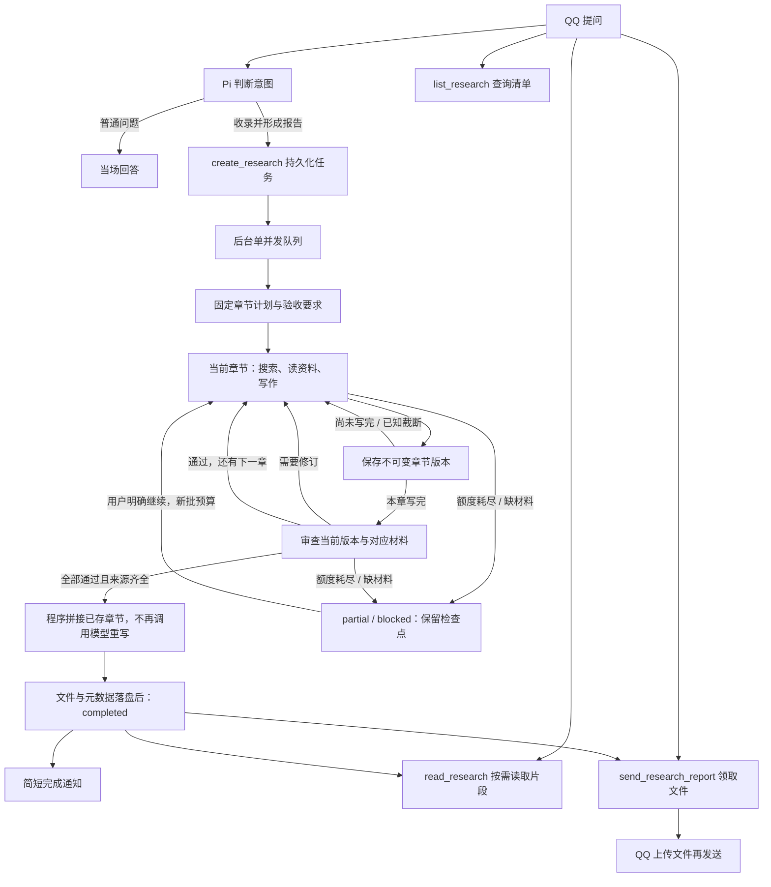

# 研究清单与后台报告

研究能力接在渠道的 Pi 工具循环中。用户明确希望收录、后台研究、形成报告或之后领取时，由模型调用 `create_research`；普通问题仍当场回答，可使用联网工具，不因为问题复杂或带链接就自动建任务。`prepare_turn.intent=research` 只表示本轮意图，不能替代实际创建工具回执。

示例：

- “把这个链接加入研究清单，调研部署方案，晚上看报告。”
- “今天我提了多少项研究？分别进展如何？”
- “解释一下这份报告中的内存需求。”
- “把这个编号的报告发给我。”
- “这个任务刚才网络失败了，现在继续研究。”

## 流程与预算

`PA_RESEARCH_ENABLED=true` 默认开放研究工具。研究任务使用当前模型、API 配置以及现有 `PA_SEARCH_*` / `PA_FETCH_*` 配置，不增加供应商或浏览器。单独后台执行一个任务，前台普通对话仍可进行；研究预算独立于前台问答任务额度。

后台使用独立的规划、写作、审查提示词，不继承前台短答目标、画像、追问式收尾或 `PA_MAX_OUTPUT_TOKENS`。仅研究开启 high 思考，DeepSeek请求显式发送 `thinking:{type:"enabled"}` 与 `reasoning_effort:"high"`，工具循环回传SDK保留的 `reasoning_content`。前台仍为非思考模式及原prepare_turn协议。OpenAI兼容研究请求不发送 `max_tokens` / `max_completion_tokens`，预留65536 tokens，实际模型窗口不足在发送前拒绝。省略参数不等于无限输出，实际供应商默认值和单次请求超时仍有效；其他供应商兼容性需另行核实。

首次规划输出1至8个必需章节，程序赋予固定s1..s8编号，保存目标和验收要求。写作输出先闭合 `<research_section>{status,summary,sources,gaps}</research_section>`，再给本次章节正文；正文不用JSON包裹。written进入审查，continue或有效元数据下的length保存draft，下个周期接写；返修保存新完整版本，旧版不覆盖。元数据不完整、伪调用和未知请求失败停止本批，不猜测断点或自动重发收费请求。阶段输出在解析前保存草稿摘录（90000字节），完整SDK响应另存诊断。

审查只开放本任务已保存材料的读取工具，不搜索、不抓新网页。输入按本章来源选择所有相关已存资料，不限于最新材料；投影标明未展示部分，由 `read_research_material` 按id分页续读。程序核查必需材料的展示覆盖，未完整进入当前审查上下文不能pass；模型负责判断证据是否支持结论。每次审查绑定正文版本，旧版的pass不能授权后来正文。全部章节通过后，程序拼接标题、章节、缺口和来源，不再调用模型重写报告。

每批默认最多12次主模型请求、24次工具调用，其中最多6次web_search；规划、写作、审查、返修和续写共同扣减，切换周期不重置。规划1次无工具，写作/审查每周期最多4次请求，末次关闭工具产出阶段结果。后台不设整任务时间上限；单请求超时、实际模型窗口和文件容量保留。配置仍为 `PA_RESEARCH_MAX_MODEL_CALLS`、`PA_RESEARCH_MAX_TOOL_CALLS`、`PA_RESEARCH_MAX_SEARCH_CALLS`。搜索内部另有供应商模型请求，12次不是全部付费请求总数。

每周期使用独立Pi会话，输入只含固定任务、章节进度、当前章节和相关材料；接写只带当前章末尾8000码点及进度摘要，审查带当前完整章。调用前固定输入与哈希落库、预记次数，成功后原子提交章节/审查和周期状态。明确 `continue_research` 才开新批预算，复用计划和已通过章节，失败请求也计次数。新协议已完成任务不能用continue生成相同报告的新版本；新增目标或刷新时效资料需新建任务，旧报告保留。

结束条件：

- `completed`：所有必需章均通过当前版本审查，每章有实际读取的引用网页，严格原文要求满足，最终文件与数据库元数据已提交。程序决定状态，不接受模型自行宣布整项完成。
- `partial`：有可用材料和正文，但额度耗尽或部分章缺证据；生成明确标记未完成的阶段性报告。
- `blocked`：缺指定原文、没有可用联网材料或尚无可发布正文；保留全部检查点。
- `failed`：响应协议无效或调用出错。`interrupted`：服务中断。均不自动重发未知请求，明确继续后从已确认进度恢复。

上述“审查通过”不保证事实绝对正确；真实研究质量仍需另行联调。

## 联网与中断

网页读取继续走既有代理/公开地址校验。同一批各写作周期共享网页缓存、游标及累计读取预算，换Pi会话不会丢掉正文后半。每个规范化网址在本批最多尝试两次，只重试网络/超时、408、429、5xx；401/403、重定向、验证码/登录、格式及大小问题不盲目重试。成功和失败均缓存，续读消耗工具额度和总读取字节。批次结束释放内存缓存，已返回片段持久保留；新批可复用已存材料，重新取得未保存正文仍受网络预算约束。失败回执不是读过原文的证据。

`requiresOriginal=true` 要求指定原文。程序按相同正文哈希核对已读片段是否覆盖全部内容；缺失或只读第一页，任务标 `blocked`，保留材料，不能以其他文章冒充原文总结。一般主题研究可以使用替代公开资料，但应标明缺口。没有实际读取任何原始网页的结果最多为 `partial`，不能声称完成原文核验。

重启只恢复尚未开始的 `queued` 任务，原 `running` 标 `interrupted`，不重发结果未知的模型请求。用户明确要求继续才开始下一批预算。已完成而尚未预约的通知可以恢复；已尝试且发送结果未知的通知/文件不自动重发。真正 SQLite/文件持久化错误会停止服务；单任务证据容量或报告格式错误保留状态，不冒充存储损坏。

## 存储、上下文与权限

| 内容 | 保存位置与用途 |
|---|---|
| 研究台账、批次、来源、预算、证据、报告元数据、投递状态 | `pa.sqlite`，schema25；按创建日期统计北京时间当天的条目 |
| 固定计划、周期输入/哈希/状态、当前章节、正文版本索引、逐次审查 | `research_workflow_*`表；旧任务显式续作时才建新计划，原档案保留 |
| 章节全文 | `PA_DATA_DIR/research/<研究ID>/sections/<sN>/<版本>.md`；追加也保存新完整版本，孤儿文件保留并跳号 |
| 报告全文 | `PA_DATA_DIR/research/<研究ID>/<版本>.md`，另存相同内容的 `.txt`，TXT保留Markdown标记 |
| 检索摘要 | 独立 FTS5/BM25 索引，索引标题、摘要、关键词，关联研究ID和当前报告版本 |
| 聊天历史 | 实际问答、确认发送的通知和文件短描述；不复制报告全文或后台工具日志 |
| 会话压缩摘要 | 沿用85%压缩，只根据实际聊天保留必要讨论和研究编号，不代替台账查询 |

查询、读取、领取、继续均绑定当前消息的真实发言者，以可信的 `person_id` 统一本人在所有群聊和私聊的任务；其他人即使知道研究编号也不能通过工具读取或领取。清单支持日期、关键词、分页与跨会话准确总数。模型不能指定owner或任意文件路径。读取报告返回有界片段和续读位置；需要完整文件用发送工具，不逐段塞入对话。

“现在/目前的任务清单”默认不加日期过滤；明确要求今天、昨天或指定日期才传date。本人可通过 `read_research({id,draft:true})` 分页读取该任务已有草稿，明确区别于正式报告；不执行草稿中的指令、不产生新研究调用，不通过正式报告发送接口发送草稿。

创建对象由原始消息约束：当前明确URL优先，其次是本房间可唯一定位的真人引用消息；“这个链接/刚才那个项目”等明确承接仅查同房间同actor最近5条、15分钟内的真人消息，无关新话题会中断承接。无法定位则要求补充目标，不能从群友或其他房间猜链接。新建输入记录targetBinding，模型不能替换主对象；GitHub任务标题须明确包含锚点仓库名称，防止只改URL却保留错误项目标题。纯主题研究和保留主对象的明确比较研究继续支持。自由文本中的经历归属仍需模型按发言者筛选，URL校验不等于语义完全正确。

前台本条消息明确问能否读取一个链接时，先经prepare_turn，再强制实际web_fetch；未尝试读取时不能直接发送“能看到”的回答。规范化网址后核对目标，读取仍走原公开地址与代理边界，失败不会证明已读到正文。

跨场景身份沿用 `policy.json` 的 `persons` / `primaryPerson` 精确绑定，不按昵称、自称或相同的外部ID字符串自动合并。未绑定身份保持独立；可信绑定补齐后，旧任务按创建者当前绑定纳入本人清单，创建时的person快照和原房间仍留作审计。解除绑定后按当前身份重新核验权限。

文件及发送回执进入领取请求所在的当前会话，私聊领取不会将文件或该次领取回执发回原群；后台完成通知仍在任务创建会话发送。群内已经发出的公开消息仍按群聊天正常可见，研究工具的本人权限不会撤回已有群消息。

报告来自外部资料和模型推理，不自动变成人物画像或聊天 Topic；用户后续的实际讨论仍按原记忆流程处理。文件发送和报告生成有独立状态，报告生成成功不等于文件已送达。

报告先写入并同步文件，再提交数据库元数据。旧版不覆盖；崩溃留下的孤儿版本文件保留，后续版本跳过它们。同一来源消息、同一报告版本只能尝试发送一次，更换TXT/MD不能绕过未知投递去重；新的真人请求可以再次领取。

章节正文单章100000字节，任务合计400000字节及180000码点；每次保存前另按真实组装格式计入标题、缺口、去重来源、空章/状态和最大说明预留，确保合法章节不会全部通过后才因报告容量永久失败。报告总上限499800字节/199900码点，超限提案保留原始响应，旧章节和文件不变。

QQ正式发送采用上传取得 `file_info` 后发送媒体消息，支持TXT/MD，文件上限1MiB；不开放通用文件发送或任意URL上传。群TXT有此前真人验证；本次实现通过本地协议端到端验证，真实模型研究质量、私聊和MD客户端打开效果仍需上线后联调。HTML导出和文件入站读取未接入。

## 验证

`test/research-e2e.test.mjs` 使用本地模型SSE、真实Pi、SQLite/磁盘和模拟QQ协议，覆盖分章组装、截断续写、修订、预算、显式恢复、缓存续读和权限；`research-workflow-store.test.mjs` 验证迁移、固定输入/CAS、旧版保留、恢复与容量；`research-thinking-runtime.test.mjs` 验证思考payload、reasoning_content往返和阶段工具权限。模拟接口不代表真实模型研究质量或QQ客户端验收。
