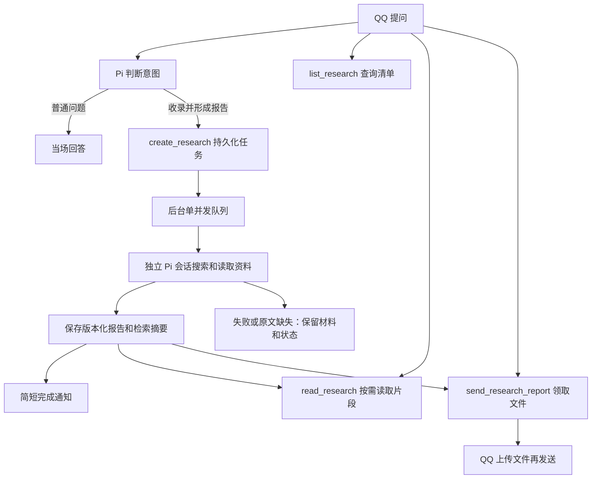

# 研究清单与后台报告

研究能力接在渠道的 Pi 工具循环中。用户明确希望收录、后台研究、形成报告或之后领取时，由模型调用 `create_research`；普通问题仍当场回答，可使用联网工具，不因为问题复杂或带链接就自动建任务。`prepare_turn.intent=research` 只表示本轮意图，不能替代实际创建工具回执。

示例：

- “把这个链接加入研究清单，调研部署方案，晚上看报告。”
- “今天我提了多少项研究？分别进展如何？”
- “解释一下这份报告中的内存需求。”
- “把这个编号的报告发给我。”
- “这个任务刚才网络失败了，现在继续研究。”

## 流程与预算

`PA_RESEARCH_ENABLED=true` 默认开放研究工具。研究任务使用当前模型、API 配置以及现有 `PA_SEARCH_*` / `PA_FETCH_*` 配置，不增加供应商或浏览器。单独后台执行一个任务，前台普通对话仍可进行；研究预算独立于前台问答任务额度。

每批默认最多 12 次主模型请求、24 次工具调用，其中最多 6 次 `web_search`。最后一次主模型请求关闭工具，用于整理已有证据；不设置整次总时间限制，继续使用单个请求超时。配置为 `PA_RESEARCH_MAX_MODEL_CALLS`、`PA_RESEARCH_MAX_TOOL_CALLS`、`PA_RESEARCH_MAX_SEARCH_CALLS`。搜索内部另有供应商模型请求，故 12 次不是全部付费请求的总数；原搜索额度和服务端搜索限制继续生效。

后台使用完整独立 Pi 工具循环，工具结果交回同一调研会话，不带整段群聊或人物画像。创建时的 `goal` 应包含任务需要的背景。已确认材料、调用计数、最终草稿持久保存；后续显式 `continue_research` 创建新批次和新预算，携带有界的已有材料与旧报告，并保留历史版本。工具或请求失败也消耗已预约次数。

## 联网与中断

网页读取继续走既有代理/公开地址校验。每个规范化网址在一个研究批次中最多尝试两次，只重试网络/超时、408、429、5xx；401/403、重定向、验证码/登录、格式及大小问题不盲目重试。成功和失败均在本批缓存，模型重复请求不会重新联网；续读已有网页只消耗读取工具额度。失败回执不是读过原文的证据，也不能据此直接断言代理故障。

`requiresOriginal=true` 要求指定原文。程序按相同正文哈希核对已读片段是否覆盖全部内容；缺失或只读第一页，任务标 `blocked`，保留材料，不能以其他文章冒充原文总结。一般主题研究可以使用替代公开资料，但应标明缺口。没有实际读取任何原始网页的结果最多为 `partial`，不能声称完成原文核验。

重启只恢复尚未开始的 `queued` 任务，原 `running` 标 `interrupted`，不重发结果未知的模型请求。用户明确要求继续才开始下一批预算。已完成而尚未预约的通知可以恢复；已尝试且发送结果未知的通知/文件不自动重发。真正 SQLite/文件持久化错误会停止服务；单任务证据容量或报告格式错误保留状态，不冒充存储损坏。

## 存储、上下文与权限

| 内容 | 保存位置与用途 |
|---|---|
| 研究台账、批次、来源、预算、证据、报告元数据、投递状态 | `pa.sqlite`，schema24；按创建日期统计北京时间当天的条目 |
| 报告全文 | `PA_DATA_DIR/research/<研究ID>/<版本>.md`，另存相同内容的 `.txt`，TXT保留Markdown标记 |
| 检索摘要 | 独立 FTS5/BM25 索引，索引标题、摘要、关键词，关联研究ID和当前报告版本 |
| 聊天历史 | 实际问答、确认发送的通知和文件短描述；不复制报告全文或后台工具日志 |
| 会话压缩摘要 | 沿用85%压缩，只根据实际聊天保留必要讨论和研究编号，不代替台账查询 |

查询、读取、领取、继续均绑定当前消息的真实发言者，以可信的 `person_id` 统一本人在所有群聊和私聊的任务；其他人即使知道研究编号也不能通过工具读取或领取。清单支持日期、关键词、分页与跨会话准确总数。模型不能指定owner或任意文件路径。读取报告返回有界片段和续读位置；需要完整文件用发送工具，不逐段塞入对话。

跨场景身份沿用 `policy.json` 的 `persons` / `primaryPerson` 精确绑定，不按昵称、自称或相同的外部ID字符串自动合并。未绑定身份保持独立；可信绑定补齐后，旧任务按创建者当前绑定纳入本人清单，创建时的person快照和原房间仍留作审计。解除绑定后按当前身份重新核验权限。

文件及发送回执进入领取请求所在的当前会话，私聊领取不会将文件或该次领取回执发回原群；后台完成通知仍在任务创建会话发送。群内已经发出的公开消息仍按群聊天正常可见，研究工具的本人权限不会撤回已有群消息。

报告来自外部资料和模型推理，不自动变成人物画像或聊天 Topic；用户后续的实际讨论仍按原记忆流程处理。文件发送和报告生成有独立状态，报告生成成功不等于文件已送达。

报告先写入并同步文件，再提交数据库元数据。旧版不覆盖；崩溃留下的孤儿版本文件保留，后续版本跳过它们。同一来源消息、同一报告版本只能尝试发送一次，更换TXT/MD不能绕过未知投递去重；新的真人请求可以再次领取。

QQ正式发送采用上传取得 `file_info` 后发送媒体消息，支持TXT/MD，文件上限1MiB；不开放通用文件发送或任意URL上传。群TXT有此前真人验证；本次实现通过本地协议端到端验证，真实模型研究质量、私聊和MD客户端打开效果仍需上线后联调。HTML导出和文件入站读取未接入。

## 验证

新增测试仅 `test/research-e2e.test.mjs` 两项端到端流程，使用本地模型SSE、真实Pi、SQLite/磁盘和模拟QQ协议，验证可观察的任务/文件/发送结果与故障恢复。它们不验证模型是否总能正确识别自然语言意图，也不把模拟接口当作真实QQ验收。
